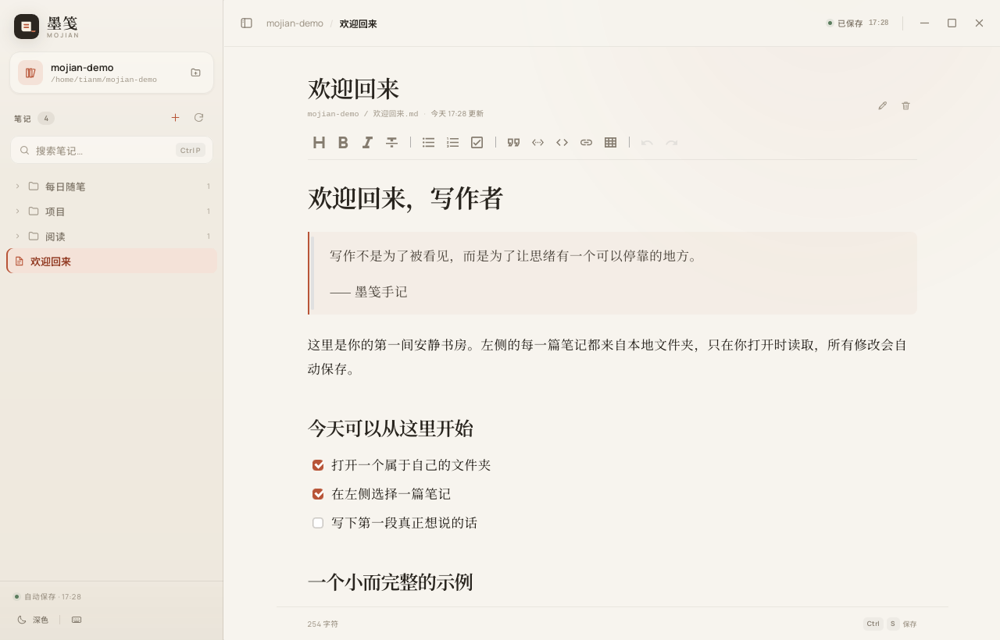
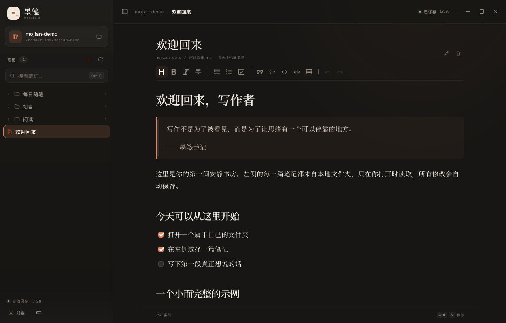
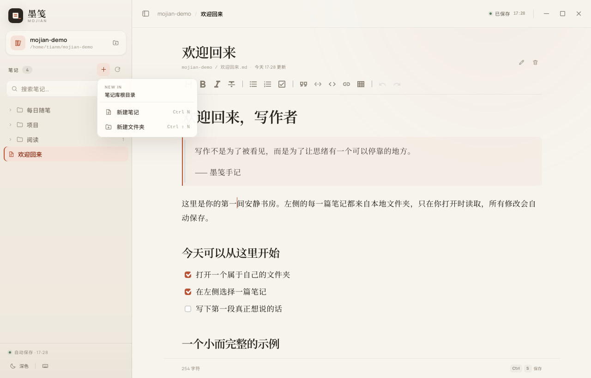
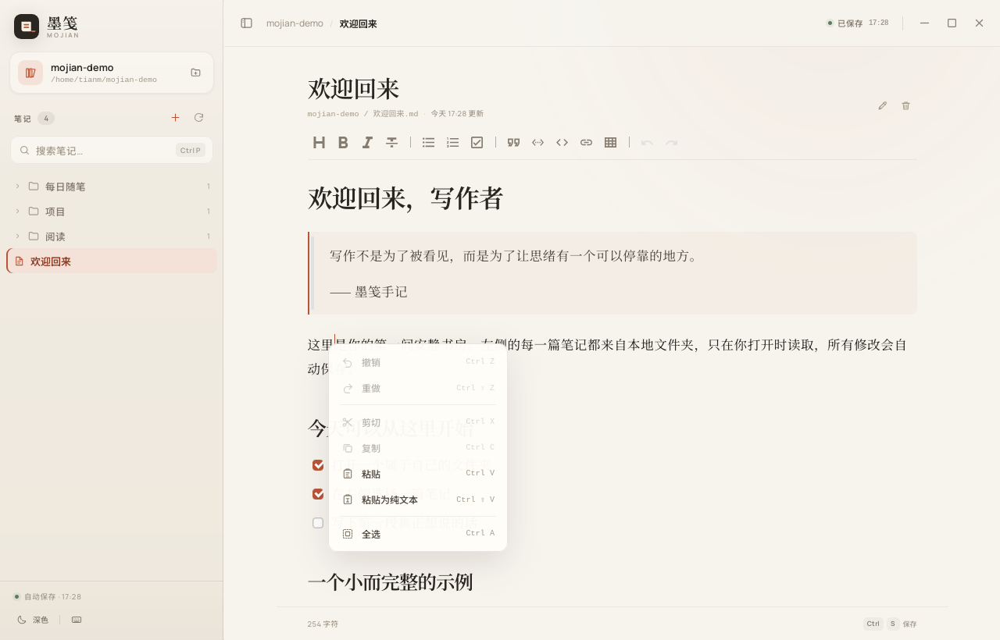

# 墨笺 · Mojian

> 安静地写，自动地存。

墨笺是一款基于 **Tauri 2** 的桌面 Markdown 编辑器。打开一个本地文件夹作为笔记库，在左侧选择 `.md` 文件，用 [Vditor](https://github.com/Vanessa219/vditor) 的 **IR 即时渲染模式**在单屏内写作。文件只在被选中时读取，每一次编辑都会自动原子写回磁盘；你也可以直接新建笔记、整理文件夹、重命名和删除笔记。


<p align="center">
  
  
</p>

## 特性

- **文件夹即笔记库**：通过原生文件夹选择器打开任意本地目录，递归发现其中的 `.md` / `.markdown` 文件。
- **完整的笔记库管理**：左侧 `+` 菜单、右键菜单和键盘快捷键可新建笔记、新建文件夹；笔记支持重命名与删除。空文件夹也会保留在树中。
- **按需加载**：扫描阶段只读取文件元信息；正文只在你选中某篇笔记时读取，不做全量预加载。
- **单屏 IR 编辑**：Vditor IR 模式将 Markdown 语法与排版结果放在同一张“纸”上，没有左右分栏。
- **实时自动保存**：编辑停止约 720ms 后自动保存；点击保存状态或 `Ctrl/⌘ + S` 可立即写入。
- **离开也不丢字**：切换笔记、刷新笔记库、窗口失焦与关闭窗口前都会按编辑器当前值强制保存；保存失败时窗口不会关闭。
- **安全文件操作**：工作区状态保存在 Rust 端；所有读写、新建、重命名与删除都经过规范化、工作区后代校验与符号链接逃逸防护。保存采用同目录临时文件 + 原子重命名。
- **无边框自绘窗口**：禁用系统标题栏与窗口边框，只保留软件界面；拖动顶部空白区域可移动窗口，右上角提供最小化、最大化 / 还原、关闭。关闭前仍会先完成保存。
- **自绘右键菜单**：编辑区右键提供撤销、重做、剪切、复制、粘贴、粘贴为纯文本与全选；笔记目录右键保留原有管理操作。系统与 WebView 默认菜单在窗口内全部禁用。
- **安静的界面**：温暖纸张色、朱砂强调色、Noto Serif 正文、可折叠文件夹树、搜索过滤、最近打开、深浅双主题。
- **完全离线**：Vditor 的 Lute 解析器、图标、代码高亮、主题 CSS 与中文字体均随应用打包，不请求 CDN。
- **原生桌面体验**：Tauri 2 窗口、系统文件夹选择器、外部链接交给系统浏览器、退出前保存保护。

## 笔记库管理

在左侧 **笔记** 标题旁的 `+` 打开新建菜单；也可以右键任意文件夹或笔记，直接在该位置执行操作。当前笔记的文档头部还提供重命名与删除按钮。

<p align="center">
  
  
</p>

- **新建笔记**：`Ctrl/⌘ + N`，或左侧 `+` / 右键菜单。输入名称后创建 `.md` 文件并自动打开。
- **新建文件夹**：`Ctrl/⌘ + ⇧ + N`，或左侧 `+` / 右键菜单。父目录必须存在，每次创建一个层级。
- **重命名笔记**：`F2`、文档头铅笔按钮，或笔记右键菜单。内容保持不变，扩展名保持不变。
- **删除笔记**：文档头垃圾桶按钮，或笔记右键菜单。确认后永久删除；如果正在编辑该笔记，删除前会先完成保存，随后关闭编辑区。

新建位置会优先跟随当前笔记所在文件夹；右键文件夹则直接在该文件夹内创建。名称会经过校验，不能包含路径分隔符、隐藏前缀或系统保留名，也不会覆盖同名文件。

## 右键菜单

墨笺接管了整个窗口的右键菜单，不再弹出 WebKit 或操作系统的原生菜单：

- **编辑区与输入框**：使用墨笺自绘菜单，提供撤销 / 重做、剪切、复制、粘贴、粘贴为纯文本与全选，并标注对应快捷键。粘贴项会在检测到剪贴板有文本后自动变为可用。
- **笔记目录**：菜单内容与原有行为保持一致——新建笔记、新建文件夹，以及笔记的重命名与删除；只是视觉样式与编辑区菜单统一。
- **其他区域**：禁用右键菜单。顶栏、文档头部、空白背景等没有可用操作的位置不会弹出任何菜单。

<p align="center">
  
</p>

“粘贴”会按 Markdown 解释剪贴板文本；“粘贴为纯文本”会转义 Markdown 语法，保留 `*`、`#`、`<` 等字符的字面形式。剪贴板读写由 Tauri 的 `clipboard-manager` 插件完成，仅授予读取和写入纯文本的最小权限。

## 快速开始

环境要求：

- Node.js 20+
- Rust stable（`cargo`、`rustc`）
- Tauri 2 的 Linux 系统依赖：`webkit2gtk-4.1`、`gtk3`、`libsoup3` 等。Debian/Ubuntu 可参考 [Tauri prerequisites](https://tauri.app/start/prerequisites/)。

安装与开发：

```bash
npm install
npm run tauri dev
```

生产构建：

```bash
npm run tauri build
```

只构建前端与检查类型：

```bash
npm run check
npm run build
```

运行 Rust 测试（29 项）：

```bash
cd src-tauri
cargo test
```

## 使用说明

1. 点击 **打开笔记库**，选择任意文件夹作为工作区。
2. 使用左侧 `+` 新建笔记或文件夹；在文件夹上右键可指定创建位置。
3. 在左侧文件夹树中选择一篇笔记，正文随即载入 Vditor。
4. 直接写作。右上角状态会依次显示“待保存 → 正在保存 → 已保存”，并记录保存时间。
5. 使用文档头部的铅笔 / 垃圾桶按钮或 `F2` 管理当前笔记。
6. 在编辑区右键可撤销、重做、剪切、复制、粘贴、粘贴为纯文本或全选；在笔记目录右键可执行笔记库操作。
7. 使用搜索框或 `Ctrl/⌘ + P` 按文件名与相对路径筛选笔记。
8. 点击侧边栏底部的主题按钮或按 `Ctrl/⌘ + ⇧ + L`，在浅色 / 深色间切换；主题和上次打开的笔记库会保留。
9. 拖动顶部栏空白处可移动窗口；右上角按钮控制最小化、最大化 / 还原与关闭。

| 快捷键 | 功能 |
| --- | --- |
| `Ctrl/⌘ + O` | 打开 / 切换笔记库 |
| `Ctrl/⌘ + N` | 新建笔记 |
| `Ctrl/⌘ + ⇧ + N` | 新建文件夹 |
| `F2` | 重命名当前笔记 |
| `Ctrl/⌘ + P` | 聚焦笔记搜索 |
| `Ctrl/⌘ + S` | 立即保存 |
| `Ctrl/⌘ + \` | 显示 / 收起侧边栏 |
| `Ctrl/⌘ + ⇧ + L` | 切换主题 |
| `Ctrl/⌘ + B` / `I` | 加粗 / 斜体（Vditor） |

文件夹会记住展开 / 收起状态；侧边栏宽度和主题也能拖动 / 切换并持久化。

## 技术架构

```text
.
├── index.html                    # 应用壳层、欢迎页、编辑器与操作对话框
├── src/
│   ├── main.ts                   # 应用状态、文件管理、自动保存、窗口生命周期
│   ├── icons.ts                  # 线性图标与图标注入
│   ├── styles.css                # 设计令牌、布局、Vditor 外观、主题
│   └── lib/
│       ├── api.ts                # Tauri command 类型化封装
│       ├── clipboard.ts          # 系统剪贴板纯文本读写（Tauri 插件 / Web API 回退）
│       ├── editor.ts             # Vditor IR 配置与主题同步
│       ├── file-tree.ts          # 笔记 + 文件夹路径 → 文件夹树 / 搜索
│       ├── format.ts             # 时间、字符统计
│       └── storage.ts            # 主题、最近打开、侧边栏状态等本地偏好
├── src-tauri/
│   ├── src/lib.rs                # Tauri 入口、命令注册、工作区状态
│   ├── src/workspace.rs          # 文件夹校验、递归扫描、笔记 / 文件夹列表
│   ├── src/security.rs           # 路径 / 名称校验、工作区后代 / 符号链接防护
│   ├── src/notes.rs              # 读取、原子保存、新建、重命名与删除
│   ├── capabilities/default.json # 窗口、目录与纯文本剪贴板的最小权限
│   └── tauri.conf.json
├── scripts/sync-vditor-assets.mjs # 将 Vditor 离线运行时资源同步到 public/
└── docs/screenshots/
```

### Rust 命令接口

| Command | 作用 |
| --- | --- |
| `open_workspace(path)` | 校验并激活文件夹，返回笔记与文件夹列表 |
| `rescan_workspace()` | 重新扫描当前笔记库 |
| `read_note(path)` | 按工作区相对路径读取单篇正文 |
| `save_note(path, content)` | 原子保存一个工作区内的 Markdown 文件 |
| `create_folder(parent, name)` | 在指定相对目录中创建一个文件夹 |
| `create_note(parent, name)` | 在指定相对目录中创建一个新的空 Markdown 文件 |
| `rename_note(path, new_name)` | 在同一目录内重命名笔记 |
| `delete_note(path)` | 删除指定的 Markdown 文件 |

返回值与参数均为 camelCase；`WorkspaceInfo` 包含 `notes` 与 `folders` 两个扁平列表，前端据此构建树。`folders` 包含空目录，因此刚创建或删空内容的文件夹不会从界面消失。

### 安全边界

- 前端不能直接访问任意路径：当前工作区是 Rust 端受管状态。
- 笔记路径必须是工作区内的相对路径；拒绝绝对路径、`C:\` / UNC、反斜杠、`.`、`..`、空段与非 Markdown 扩展名。
- 新建 / 重命名的名称必须是单一路径段：拒绝斜杠、空名称、隐藏前缀、`.` / `..`、控制字符、Windows 保留设备名、尾随空格 / 点号，并保持文件扩展名为 `.md` / `.markdown`。
- 父目录会先校验每个路径段、再 canonicalize，并且必须仍是工作区后代；符号链接逃逸会被拒绝。
- 扫描不跟随符号链接；跳过隐藏项以及 `node_modules`、`target`、`dist`、`build` 等常见噪声目录。
- 保存：同目录隐藏临时文件 → 写入 → 保留原权限 → `sync_all` → 原子重命名；失败时清理临时文件。
- 新建采用 `create_new` 且不覆盖已有文件；重命名只在同一目录内进行并拒绝已存在的目标；删除只接受已解析的工作区 Markdown 文件。
- 剪贴板只在用户打开自绘菜单时通过 `clipboard-manager` 读取或写入纯文本；capability 仅授予 `allow-read-text` 与 `allow-write-text`，不启用图片、HTML 或系统剪贴板监听。

### 自动保存策略

- 输入后 720ms 防抖自动保存，避免每个按键都写盘。
- 保存操作串行化；保存过程中出现的新内容会在本次写入完成后继续落盘。
- 关闭窗口 / 切换笔记 / 刷新前，会直接读取 Vditor 当前值并强制保存，不依赖输入回调的调度时序。
- 删除当前笔记前会先完成保存，避免删除后仍有迟到的写入把文件重新创建出来。
- 保存失败时状态变为“保存失败”，并提供重试；关闭窗口会因此被阻止，直到保存成功。

### 离线资源

`npm run dev` 与 `npm run build` 之前会自动执行 `scripts/sync-vditor-assets.mjs`，把 Lute、Material 图标、中文 i18n、GitHub 代码高亮主题等从 `node_modules` 同步到 `public/vditor`。Vditor 的 `cdn` 指向本地 `/vditor`，因此运行期无需网络。

## 开发路线

本项目按以下阶段完成：

1. **基础与设计系统** —— Tauri 2 + Vite + TypeScript 脚手架，窗口配置、字体、主题令牌与应用图标。
2. **安全文件层** —— Rust 工作区状态、递归扫描、路径校验、按需读取、原子保存与单元测试。
3. **编辑体验** —— Vditor IR 单屏编辑器、工具栏、文件树、搜索、最近打开、字数统计与自动保存状态。
4. **笔记库管理** —— 新建空文件夹与笔记、重命名、删除、上下文菜单、操作对话框，以及安全文件名校验。
5. **集成与验收** —— 原生文件夹选择、无边框窗口控件与拖拽、自绘右键菜单、自动保存写盘验证、删除 / 重命名 / 空文件夹验证、关闭按钮保存验证、深浅主题验收。
6. **交付与文档** —— 离线资源同步、应用元数据、README、截图、Git 历史与 Debian 安装包。

当前 Rust 测试共 **29 项**，覆盖路径穿越、符号链接逃逸、名称校验、不覆盖目标、重命名内容保留、删除边界、空文件夹扫描和 camelCase 负载。

## 已知边界

- 这是桌面应用；直接运行纯浏览器版本时，打开本地文件夹功能不可用。
- 外部程序修改文件后需要点击“刷新笔记库”重新扫描；当前不监听底层文件变化。
- 符号链接会被有意忽略（既是逃逸防护，也避免环路）。
- 为保持离线与轻量，当前未启用数学公式 / Mermaid 等重运行时渲染；代码高亮与完整 Markdown 排版可用。
- 文件夹创建为单层且不支持重命名 / 删除文件夹；当前没有回收站，删除笔记不可撤销。
- 仅支持 `.md` / `.markdown` 笔记文件；新建笔记固定以 `.md` 创建。
- 右键菜单的“粘贴”读取剪贴板纯文本；从网页或文档复制的富文本、图片不会保留原有格式。

## 设计说明

界面的核心是“纸感”而不是“后台面板感”：暖白纸张底色、极细分割线、朱砂色焦点、衬线正文，以及尽量退后的工具栏。深色主题使用墨色背景与更柔和的暖珊瑚色强调，保持夜间阅读的对比度而不刺眼。笔记库管理入口保持轻量：默认只看得到一颗朱砂色的 `+`，需要时再展开菜单或右键。右键菜单使用同一套设计令牌，但收紧了行高与字号，让它更接近桌面原生菜单，而不是网页浮层。窗口本身去掉系统边框，顶部栏只保留位置与保存状态，把最小化、最大化 / 还原、关闭放在右上角。

---

用 Markdown 写 Markdown。愿你在这里找到自己的节奏。
